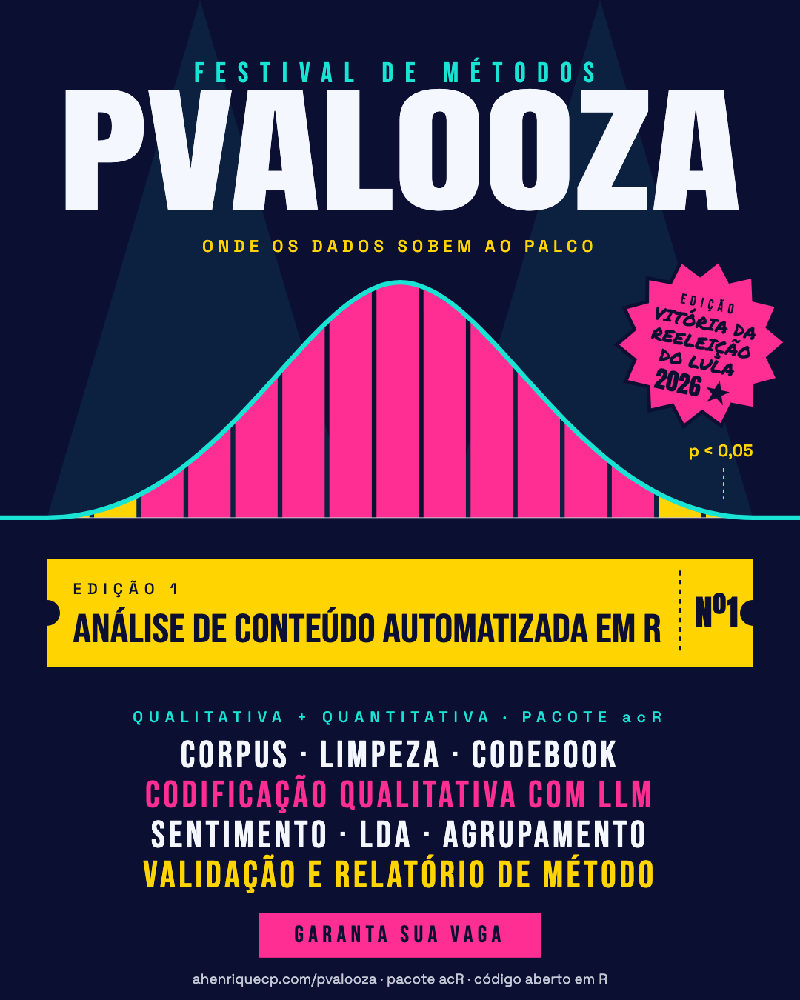

```{=html}
<div class="pv-faixa" aria-hidden="true"><div class="trilho"><span>ANÁLISE DE CONTEÚDO AUTOMATIZADA EM R <i>✺</i> 4 A 8 DE JANEIRO DE 2027 <i>✺</i> 160 VAGAS <i>✺</i> GRATUITO <i>✺</i> ONLINE <i>✺</i> ANÁLISE DE CONTEÚDO AUTOMATIZADA EM R <i>✺</i> 4 A 8 DE JANEIRO DE 2027 <i>✺</i> 160 VAGAS <i>✺</i> GRATUITO <i>✺</i> ONLINE <i>✺</i> ANÁLISE DE CONTEÚDO AUTOMATIZADA EM R <i>✺</i> 4 A 8 DE JANEIRO DE 2027 <i>✺</i> 160 VAGAS <i>✺</i> GRATUITO <i>✺</i> ONLINE <i>✺</i> </span><span>ANÁLISE DE CONTEÚDO AUTOMATIZADA EM R <i>✺</i> 4 A 8 DE JANEIRO DE 2027 <i>✺</i> 160 VAGAS <i>✺</i> GRATUITO <i>✺</i> ONLINE <i>✺</i> ANÁLISE DE CONTEÚDO AUTOMATIZADA EM R <i>✺</i> 4 A 8 DE JANEIRO DE 2027 <i>✺</i> 160 VAGAS <i>✺</i> GRATUITO <i>✺</i> ONLINE <i>✺</i> ANÁLISE DE CONTEÚDO AUTOMATIZADA EM R <i>✺</i> 4 A 8 DE JANEIRO DE 2027 <i>✺</i> 160 VAGAS <i>✺</i> GRATUITO <i>✺</i> ONLINE <i>✺</i> </span></div></div>

<section class="pv-hero pv-hero2">
  <svg class="pv-doodle d1" viewBox="0 0 60 60" aria-hidden="true"><path d="M30 4l6 17 18 1-14 11 5 18-15-10-15 10 5-18L6 22l18-1z" fill="none" stroke="#FFD400" stroke-width="3" stroke-linejoin="round"/></svg>
<svg class="pv-doodle d2" viewBox="0 0 60 60" aria-hidden="true"><path d="M34 4L14 34h14l-4 22 22-32H32z" fill="#FF2E93"/></svg>
<svg class="pv-doodle d3" viewBox="0 0 80 40" aria-hidden="true"><path d="M2 20c8-16 14-16 22 0s14 16 22 0 14-16 22 0" fill="none" stroke="#19E3D3" stroke-width="4" stroke-linecap="round"/></svg>
<svg class="pv-doodle d4" viewBox="0 0 60 60" aria-hidden="true"><path d="M30 6v48M6 30h48M13 13l34 34M47 13L13 47" stroke="#FF2E93" stroke-width="4" stroke-linecap="round"/></svg>
<svg class="pv-doodle d5" viewBox="0 0 60 60" aria-hidden="true"><circle cx="30" cy="30" r="22" fill="none" stroke="#19E3D3" stroke-width="3" stroke-dasharray="4 6"/><circle cx="22" cy="25" r="2.5" fill="#19E3D3"/><circle cx="38" cy="25" r="2.5" fill="#19E3D3"/><path d="M20 36c6 8 14 8 20 0" fill="none" stroke="#19E3D3" stroke-width="3" stroke-linecap="round"/></svg>

  <div class="pv-hero2-texto">
    <p class="pv-festival">FESTIVAL DE MÉTODOS</p>
    <span class="pv-titulo">PVALOOZA</span>
    <p class="pv-tag">Onde os dados sobem ao palco</p>
    <div class="pv-ingresso">
      <div class="corpo"><div class="ed">EDIÇÃO 1</div><div class="nome">ANÁLISE DE CONTEÚDO AUTOMATIZADA EM R</div></div>
      <div class="canhoto">Nº1</div>
    </div>
    <div class="pv-meta">
      <span><b>4 a 8 de janeiro de 2027</b></span>
      <span><b>15 horas</b> · online, pelo Google Meet</span>
      <span><b>160 vagas</b> · 80 por turno</span>
    </div>
    <a class="pv-botao" href="https://docs.google.com/forms/d/e/1FAIpQLSe2-oOutoCCMwU2k0ZJ7mFym5xcKYJS_mbN-rxWK4q4XTCerg/viewform">INSCREVA-SE</a>
    <a class="pv-botao secundario" href="#lineup">VER O LINE-UP</a>
  </div>
  <figure class="pv-hero2-cartaz">
    
    <a class="pv-botao secundario pequeno" href="img/cartaz.png" download="cartaz-pvalooza.png">BAIXAR O CARTAZ</a>
  </figure>
  <div class="pv-adesivo" role="note" aria-label="Edição Vitória da Reeleição do Lula 2026">
    <span class="topo">EDIÇÃO</span><span class="meio">VITÓRIA DA REELEIÇÃO<br>DO LULA</span><span class="base">2026 ★</span>
  </div>
  <svg class="pv-curva" viewBox="0 232 680 242" preserveAspectRatio="xMidYMax meet" xmlns="http://www.w3.org/2000/svg" role="img" aria-label="Histograma com curva normal"><path d="M40 470L76 465.7L76 470Z" fill="#FFD400"/><path d="M80 470L80 464.9L116 451.6L116 470Z" fill="#FFD400"/><path d="M120 470L120 449.7L156 426.6L156 470Z" fill="#FF2E93"/><path d="M160 470L160 423.4L196 391.1L196 470Z" fill="#FF2E93"/><path d="M200 470L200 387.1L236 348.2L236 470Z" fill="#FF2E93"/><path d="M240 470L240 343.6L276 305.6L276 470Z" fill="#FF2E93"/><path d="M280 470L280 301.6L316 275.7L316 470Z" fill="#FF2E93"/><path d="M320 470L320 274.3L340 270L356 272.9L356 470Z" fill="#FF2E93"/><path d="M360 470L360 274.3L396 298.1L396 470Z" fill="#FF2E93"/><path d="M400 470L400 301.6L436 339.3L436 470Z" fill="#FF2E93"/><path d="M440 470L440 343.6L476 383L476 470Z" fill="#FF2E93"/><path d="M480 470L480 387.1L516 420.1L516 470Z" fill="#FF2E93"/><path d="M520 470L520 423.4L556 447.5L556 470Z" fill="#FF2E93"/><path d="M560 470L560 449.7L596 464L596 470Z" fill="#FFD400"/><path d="M600 470L600 464.9L636 469.7L636 470Z" fill="#FFD400"/><line x1="0" y1="470" x2="680" y2="470" stroke="#F5F7FF" stroke-width="1" opacity="0.5"/><path d="M0 470L40 470C190 470 260 270 340 270C420 270 490 470 640 470L680 470" fill="none" stroke="#19E3D3" stroke-width="4" stroke-linecap="round" stroke-linejoin="round"/><text x="640" y="418" text-anchor="end" font-family="Space Grotesk, Arial, sans-serif" font-size="14" font-weight="500" fill="#FFD400">p &lt; 0,05</text><line x1="615" y1="428" x2="615" y2="454" stroke="#FFD400" stroke-width="1" stroke-dasharray="3 3"/></svg>
</section>

<nav class="pv-abas" aria-label="Seções da página">
  <a href="#lineup" class="atual">LINE-UP</a>
  <a href="#palcos">PALCOS</a>
  <a href="#sorteio">SORTEIO</a>
  <a href="#calendario">CALENDÁRIO</a>
  <a href="#preparacao">PREPARAÇÃO</a>
</nav>

<section id="lineup" class="pv-sec escuro">
  <div class="in">
    <h2 class="pv-h2">LINE-UP</h2>
    <p class="pv-sub">Cinco dias, cinco atrações. Cada encontro tem 3 blocos e 2 pausas de 10 minutos.</p>
    <section class="pv-lineup-cartaz pv-revela">
      <p class="pv-sobre-titulo">LINE-UP</p>
      <div class="pv-set"><span class="dia">SEG · 4/1</span><span class="atracao a1">CORPUS</span><span class="under">importação · xlsx, docx, pdf · discursos da Câmara</span></div>
      <div class="pv-set"><span class="dia">TER · 5/1</span><span class="atracao a2">TEXTO LIMPO</span><span class="under">tokens · stopwords · TF-IDF · KWIC · dicionários</span></div>
      <div class="pv-set"><span class="dia">QUA · 6/1</span><span class="atracao a3">LDA</span><span class="under">keyness · coocorrência · Wordscores · tópicos</span></div>
      <div class="pv-set"><span class="dia">QUI · 7/1</span><span class="atracao a4">LLM</span><span class="under">codebook · prompts · classificação · custo · riscos</span></div>
      <div class="pv-set"><span class="dia">SEX · 8/1</span><span class="atracao a5">VALIDAÇÃO</span><span class="under">kappa · Krippendorff · Gwet · relatório · mini-projeto</span></div>
    </section>
    <div class="pv-tres">
      <a class="pv-chamada preta pv-revela" href="#palcos"><span class="barras"><i></i><i></i><i></i><i></i></span><b>PALCOS</b><span>Manhã ou noite, 80 vagas em cada.</span><u>ESCOLHA SEU PALCO →</u></a>
      <a class="pv-chamada verde pv-revela" href="#sorteio"><b>SORTEIO</b><span>Cotas, paridade e regras claras.</span><u>VER AS REGRAS →</u></a>
      <a class="pv-chamada azul pv-revela" href="programa.html"><b>PROGRAMA</b><span>Cada bloco, cada função do acR.</span><u>LER O PROGRAMA →</u></a>
    </div>
  </div>
</section>

<div class="pv-rasgo" style="--topo:#0B1033;--base:#FF2E93" aria-hidden="true"><svg viewBox="0 0 1000 100" preserveAspectRatio="none"><rect width="1000" height="100" fill="#0B1033"/><polygon points="0,100 0,55 18,60 52,38 68,69 85,58 117,38 147,48 162,40 189,61 205,50 221,70 248,38 280,42 301,75 335,72 350,71 382,60 397,49 412,70 430,53 457,44 488,42 520,54 551,78 570,41 602,71 636,47 661,41 692,80 708,71 723,74 743,66 774,62 798,64 830,64 855,54 876,85 895,79 916,40 948,54 978,66 1000,100" fill="#FF2E93"/><g class="selos"><text x="40" y="26">★ p &lt; 0,05 ★</text><text x="360" y="26">★ PVALOOZA ★</text><text x="680" y="26">★ p &lt; 0,05 ★</text></g></svg></div>

<section id="palcos" class="pv-sec degrade">
  <div class="in">
    <h2 class="pv-h2 escuro-txt">PALCOS</h2>
    <p class="pv-sub escuro-txt">O conteúdo é o mesmo nos dois turnos. Horário de Brasília, pelo Google Meet.</p>
    <div class="pv-pilulas" role="tablist" aria-label="Escolha o palco">
      <button role="tab" class="ativa" data-palco="manha">PALCO MANHÃ</button>
      <button role="tab" data-palco="noite">PALCO NOITE</button>
    </div>
    <section class="pv-palcos pv-revela">
      <div class="palco manha" data-p="manha"><div class="rotulo">PALCO</div><div class="nome">MANHÃ</div><div class="hora">9h às 12h</div><p>80 vagas · início às 9h00 · três blocos e duas pausas</p></div>
      <div class="palco noite" data-p="noite"><div class="rotulo">PALCO</div><div class="nome">NOITE</div><div class="hora">18h30 às 21h30</div><p>80 vagas · início às 18h30 · três blocos e duas pausas</p></div>
    </section>
    <div class="pv-grade pv-revela">
      <div class="pv-card"><div class="rotulo">Quando</div><div class="valor">4 a 8 JAN</div><p>De 2027 (datas a confirmar em dezembro de 2026). Cinco encontros de 3 horas.</p></div>
      <div class="pv-card"><div class="rotulo">Ingresso</div><div class="valor">GRATUITO</div><p>Sem custo. Aulas ao vivo, sem gravação.</p></div>
      <div class="pv-card"><div class="rotulo">Vagas</div><div class="valor">160 · SORTEIO</div><p>Entre inscritos elegíveis, 80 por turno.</p></div>
      <div class="pv-card"><div class="rotulo">Para quem</div><div class="valor">R BÁSICO+</div><p>Graduação, pós e profissionais, com um projeto que envolva texto.</p></div>
    </div>
  </div>
</section>

<div class="pv-rasgo" style="--topo:#F5F7FF;--base:#0B1033" aria-hidden="true"><svg viewBox="0 0 1000 100" preserveAspectRatio="none"><rect width="1000" height="100" fill="#F5F7FF"/><polygon points="0,100 0,55 18,60 52,38 68,69 85,58 117,38 147,48 162,40 189,61 205,50 221,70 248,38 280,42 301,75 335,72 350,71 382,60 397,49 412,70 430,53 457,44 488,42 520,54 551,78 570,41 602,71 636,47 661,41 692,80 708,71 723,74 743,66 774,62 798,64 830,64 855,54 876,85 895,79 916,40 948,54 978,66 1000,100" fill="#0B1033"/><g class="selos"><text x="40" y="26">★ p &lt; 0,05 ★</text><text x="360" y="26">★ PVALOOZA ★</text><text x="680" y="26">★ p &lt; 0,05 ★</text></g></svg></div>

<section id="sorteio" class="pv-sec escuro">
  <div class="in">
    <h2 class="pv-h2">SORTEIO E REGRAS</h2>
    <p class="pv-sub">Inscrever-se não garante a vaga. A seleção é por sorteio entre inscritos elegíveis.</p>
    <details class="pv-acc pv-revela" open><summary><span class="t">COMO FUNCIONA</span><span class="selo">160 VAGAS</span></summary><div class="corpo"><p>O sorteio é feito entre quem preenche os requisitos do formulário, com <b>cotas por região, nível acadêmico e cor ou raça, e paridade de gênero</b>. O resultado é enviado por e-mail; quem for sorteado(a) confirma interesse, e a vaga de quem não confirmar passa à lista de espera.</p></div></details>
    <details class="pv-acc pv-revela"><summary><span class="t">PRÉ-REQUISITOS</span><span class="selo">R BÁSICO+</span></summary><div class="corpo"><p>R básico ou intermediário e um projeto (em andamento ou previsto) que envolva texto. É preciso computador com permissão para instalar R e RStudio, conta Google e disponibilidade nos 5 dias, no turno escolhido.</p></div></details>
    <details class="pv-acc pv-revela"><summary><span class="t">CERTIFICADO</span><span class="selo">SEM CERTIFICADO</span></summary><div class="corpo"><p>Não haverá certificado nesta edição. O formulário pergunta se há interesse em uma declaração de participação.</p></div></details>
    <details class="pv-acc pv-revela"><summary><span class="t">AULAS E APOIO</span><span class="selo">AO VIVO</span></summary><div class="corpo"><p>As aulas não serão gravadas. As dúvidas fora do Meet são respondidas pelas Discussions e Issues do repositório no GitHub (conta gratuita).</p></div></details>
    <details class="pv-acc pv-revela"><summary><span class="t">DADOS E PRIVACIDADE</span><span class="selo">LGPD</span></summary><div class="corpo"><p>Os dados, inclusive os de cor ou raça e de gênero (sensíveis), são usados apenas para as cotas e a paridade do sorteio e para organizar o curso. Os dados são apagados ao fim do curso, exceto os agregados e anônimos.</p></div></details>
    <p class="pv-cta-centro"><a class="pv-botao" href="https://docs.google.com/forms/d/e/1FAIpQLSe2-oOutoCCMwU2k0ZJ7mFym5xcKYJS_mbN-rxWK4q4XTCerg/viewform">INSCREVA-SE ATÉ 15/11</a></p>
  </div>
</section>

<div class="pv-rasgo" style="--topo:#0B1033;--base:#F5F7FF" aria-hidden="true"><svg viewBox="0 0 1000 100" preserveAspectRatio="none"><rect width="1000" height="100" fill="#0B1033"/><polygon points="0,100 0,55 18,60 52,38 68,69 85,58 117,38 147,48 162,40 189,61 205,50 221,70 248,38 280,42 301,75 335,72 350,71 382,60 397,49 412,70 430,53 457,44 488,42 520,54 551,78 570,41 602,71 636,47 661,41 692,80 708,71 723,74 743,66 774,62 798,64 830,64 855,54 876,85 895,79 916,40 948,54 978,66 1000,100" fill="#F5F7FF"/><g class="selos"><text x="40" y="26">★ p &lt; 0,05 ★</text><text x="360" y="26">★ PVALOOZA ★</text><text x="680" y="26">★ p &lt; 0,05 ★</text></g></svg></div>

<section id="calendario" class="pv-sec claro">
  <div class="in">
    <h2 class="pv-h2 escuro-txt">CALENDÁRIO</h2>
    <ul class="pv-linha-tempo pv-revela">
      <li><div class="data">Até 15 de novembro de 2026 <small>inscrições</small></div><a href="https://docs.google.com/forms/d/e/1FAIpQLSe2-oOutoCCMwU2k0ZJ7mFym5xcKYJS_mbN-rxWK4q4XTCerg/viewform">Formulário de inscrição</a></li>
      <li><div class="data">Até 20 de novembro <small>resultado do sorteio, por e-mail</small></div></li>
      <li><div class="data">Até 15 de dezembro <small>sorteados confirmam interesse</small></div></li>
      <li><div class="data">Até 27 de dezembro <small>lista final</small></div></li>
      <li><div class="data">4 a 8 de janeiro de 2027 <small>o festival</small></div></li>
    </ul>
  </div>
</section>

<div class="pv-rasgo" style="--topo:#F5F7FF;--base:#0B1033" aria-hidden="true"><svg viewBox="0 0 1000 100" preserveAspectRatio="none"><rect width="1000" height="100" fill="#F5F7FF"/><polygon points="0,100 0,55 18,60 52,38 68,69 85,58 117,38 147,48 162,40 189,61 205,50 221,70 248,38 280,42 301,75 335,72 350,71 382,60 397,49 412,70 430,53 457,44 488,42 520,54 551,78 570,41 602,71 636,47 661,41 692,80 708,71 723,74 743,66 774,62 798,64 830,64 855,54 876,85 895,79 916,40 948,54 978,66 1000,100" fill="#0B1033"/><g class="selos"><text x="40" y="26">★ p &lt; 0,05 ★</text><text x="360" y="26">★ PVALOOZA ★</text><text x="680" y="26">★ p &lt; 0,05 ★</text></g></svg></div>

<section id="preparacao" class="pv-sec escuro">
  <div class="in">
    <h2 class="pv-h2">PREPARAÇÃO</h2>
    <p class="pv-sub">As <b>instruções de preparação serão enviadas por e-mail, mais perto do curso</b>. Quem quiser adiantar pode ver os tutoriais.</p>
    <div class="pv-pilulas fixas">
      <a href="tutorial_github.html">1 · CONTA NO GITHUB</a>
      <a href="tutorial_instalacao.html">2 · R, RSTUDIO E PACOTES</a>
      <a href="tutorial_api_gemini_groq.html">3 · CHAVES DE API</a>
    </div>
    <div class="pv-docente pv-revela">
      
      <div><b>Docente: Anderson Henrique (CEM/USP)</b><br>Autor do pacote <a href="https://ahenriquecp.com/acR/">acR</a>. <a href="sobre.html">Sobre mim →</a></div>
    </div>
    <div class="pv-aviso-legal">
      <b>Evento acadêmico independente.</b> "Pvalooza" é uma brincadeira com o p-valor e com a linguagem dos festivais de música. Não há relação com o Lollapalooza nem com seus organizadores, e nenhuma marca, logotipo ou imagem deles é usada aqui. Ilustrações e identidade visual originais.
    </div>
  </div>
</section>


```
